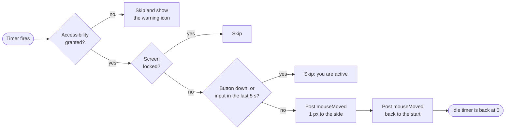

# Mouse Mover


A tiny native macOS menu bar app that keeps your Mac awake while you want it to.

Switch it on, and it moves the cursor **1 pixel and back** once a minute. You
do not see the move, but macOS counts it as real activity, so the screen saver
does not start. Switch it off, and it does nothing at all.

- **One switch.** Enable or Disable from the menu bar. No windows, no Dock icon.
- **Real input, no clicks.** It posts real `mouseMoved` events. It never clicks and never types.
- **Stays out of your way.** It skips a move while you use the mouse or keyboard, while a button is down, and while the screen is locked.
- **Remembers you.** On/off and the interval survive a quit and a relaunch.
- **Small.** About 330 lines of Swift and SwiftUI. No dependencies.

> [!NOTE]
> Many organizations set a screen lock for good reasons. If your Mac is
> managed by your company, check its policy before you use this app.

## Contents

- [How it works](#how-it-works)
- [Requirements](#requirements)
- [Build and run](#build-and-run)
- [Grant the Accessibility permission](#grant-the-accessibility-permission)
- [Use it](#use-it)
- [Check that it works](#check-that-it-works)
- [Limits](#limits)
- [Settings and reset](#settings-and-reset)
- [Project layout](#project-layout)

## How it works

macOS keeps a system idle timer (`HIDIdleTime`). Each key press or mouse event
sets it back to 0. The screen saver and the screen lock start when this timer
reaches the limit in your settings.

While Mouse Mover is on, a timer fires at the interval you choose:



The two events go to the HID event tap (`CGEvent.post(tap: .cghidEventTap)`).
This is the same path as a real mouse, so the idle timer resets. A plain
`CGWarpMouseCursorPosition` moves the cursor but does **not** reset the idle
timer, so the app does not use it.

While Mouse Mover is off, no timer runs and the app posts no events.

## Requirements

| Item | Version |
|---|---|
| macOS | 14 Sonoma or later |
| Mac | Apple Silicon (arm64) |
| Tools | Xcode or the Command Line Tools, with Swift 6 |

## Build and run

```bash
git clone https://github.com/CastilloLuis/mouse-mover.git
```

```bash
cd mouse-mover
```

```bash
make run
```

`make run` builds `build/MouseMover.app`, signs it ad hoc, and opens it. Look
for the mouse icon at the top right of your screen.

| Command | What it does |
|---|---|
| `make build` | Builds and signs `build/MouseMover.app` |
| `make run` | Builds, then opens the app |
| `make stop` | Quits the app |
| `make clean` | Removes all build output |

## Grant the Accessibility permission

macOS lets an app post mouse events only with the Accessibility permission.
You do this one time.

1. Click the menu bar icon, then click **Enable**.
2. macOS shows a dialog. Click **Open System Settings**.
3. In **Privacy & Security > Accessibility**, turn on **Mouse Mover**.
4. Within 2 seconds, the icon changes from a warning triangle to a filled mouse.

If you closed the dialog, click **Grant Accessibility Permission…** in the menu.

> [!IMPORTANT]
> The build has an ad hoc signature, and macOS ties the permission to that
> exact binary. After you change the code and rebuild, the old permission no
> longer applies. Remove Mouse Mover from the Accessibility list with the minus
> button, then grant it again.
>
> To keep the permission across rebuilds, sign with your own identity:
>
> ```bash
> make build SIGN_ID="Apple Development: Your Name (TEAMID)"
> ```

## Use it

Click the icon in the menu bar:

| Menu item | What it does |
|---|---|
| **Enable** / **Disable** | Turns the moves on or off (⌘E) |
| **Interval** | 30 s, 1 min (default), 2 min or 5 min |
| **Grant Accessibility Permission…** | Shows only when the permission is missing |
| **Launch at Login** | Starts the app when you log in |
| **Quit Mouse Mover** | Quits the app (⌘Q) |

The icon shows the state:

| Icon | State |
|---|---|
| Outline mouse | Off |
| Filled mouse | On and working |
| Warning triangle | On, but the Accessibility permission is missing |

The first lines of the menu show the state and the time of the last move.

## Check that it works

Print the system idle time, in seconds:

```bash
ioreg -c IOHIDSystem | awk '/HIDIdleTime/ {print $NF/1000000000; exit}'
```

While the app is on and you do not touch anything, the value climbs to about
the interval and then drops back near 0. While it is off, the value keeps
growing.

See each move the app makes:

```bash
/usr/bin/log show --last 10m --predicate 'subsystem == "local.MouseMover"' --style compact
```

Results from a test on an M4 Pro, 1 min interval, with no input in the
minute before each move:

| Move | Idle time before (s) | Idle time after (s) |
|---|---|---|
| 1 | 60.0 | 0.09 |
| 2 | 60.0 | 0.10 |

Sampled every 5 s, the idle time climbed to 55.4 s and 56.7 s, then dropped
back near 0 at each move. With the app off, the idle time grew from 434 s to
2557 s over 35 minutes, with no drops.

## Limits

| Case | What happens |
|---|---|
| You close the lid, or the Mac sleeps | The Mac locks as normal. |
| The screen is already locked | The app skips moves, so the display can sleep. |
| You quit the app | No moves. The idle timer runs as normal. |
| You restart the Mac | The app starts only if **Launch at Login** is on. It remembers its last on/off state. |
| You rebuild after a code change | Grant the Accessibility permission again (see above). |

## Settings and reset

The app keeps its settings in `UserDefaults`, domain `local.MouseMover`:

| Key | Meaning |
|---|---|
| `enabled` | `1` when on |
| `intervalSeconds` | Seconds between moves (default 60) |

Read them:

```bash
defaults read local.MouseMover
```

Reset them (quit the app first):

```bash
defaults delete local.MouseMover
```

## Project layout

```text
mouse-mover/
├── Makefile                    build, run, stop, clean
├── Package.swift               Swift package (macOS 14+)
├── Resources/
│   └── Info.plist              bundle info, LSUIElement (no Dock icon)
└── Sources/MouseMover/
    ├── MouseMoverApp.swift     MenuBarExtra and the menu
    └── Mover.swift             timer, event posting, permission, settings
```
